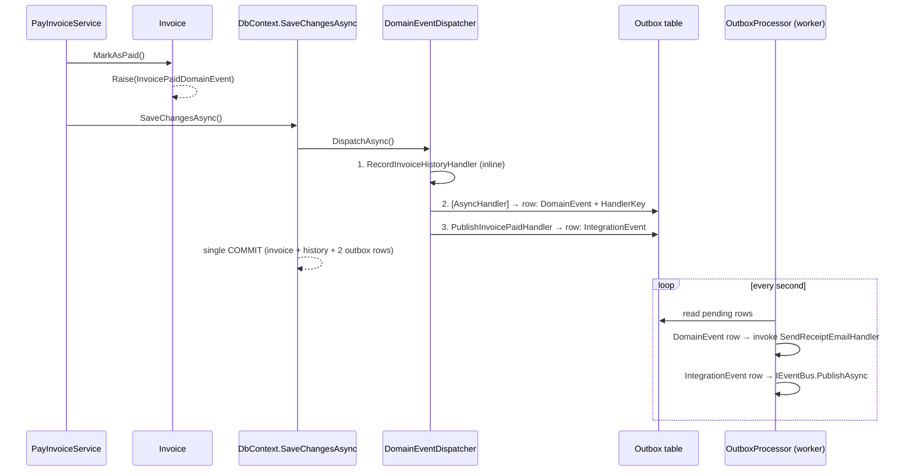

# Domain Events & Transactional Outbox in .NET

[](https://github.com/rezabazvand/dotnet-domain-events-outbox/actions/workflows/build.yml)

A small, runnable .NET 10 sample that shows **one domain event triggering three very different reactions**, and why each one belongs on a different execution path.

An invoice gets paid. Three things must happen:

| # | Handler | Runs | Why |
|---|---------|------|-----|
| 1 | `RecordInvoiceHistoryHandler` | **Synchronously**, inside the same transaction | History must be atomic with the status change. If it fails, the whole payment rolls back. |
| 2 | `SendReceiptEmailHandler` `[AsyncHandler]` | **Later**, via the outbox (the dispatcher stores the *domain event* + handler key) | Sending an email is external I/O. It must not hold a DB transaction open, and a rollback can't "unsend" an email. |
| 3 | `PublishInvoicePaidHandler` | Synchronously writes an **integration event** to the outbox; a worker publishes it later | Other services must only hear about the payment if it was really committed, but publishing must not block the transaction. |

The domain model knows nothing about any of this: `Invoice.MarkAsPaid()` only raises `InvoicePaidDomainEvent`.

## The two bugs this avoids

```csharp
invoice.MarkAsPaid();

await email.SendReceiptAsync(customer);
await bus.PublishAsync(new InvoicePaid(invoice.Id));

await db.SaveChangesAsync();
```

- **Too early:** the receipt goes out and the event is published, then `SaveChangesAsync` fails. The database says unpaid; the customer and every other service say paid.
- **Too late:** save first, then the process crashes right after the commit. The invoice is paid, but the receipt and the event are lost.

The database write and the message are two separate writes. The outbox turns them into one.

## The flow



## Run it

Requires the [.NET 10 SDK](https://dotnet.microsoft.com/download).

```bash
dotnet run --project src/SampleOutbox.Host
```

The console app walks through five steps:

1. An invoice is created and issued.
2. `MarkAsPaid()` is called and committed.
3. **Right after the commit**: the history row already exists (synchronous), but both outbox rows are still `PENDING` and no receipt has been emailed.
4. The `OutboxProcessor` starts. The fake mail server **fails on the first attempt on purpose**, so you can see the retry with backoff, then the successful send and the integration event being published.
5. Final state: every outbox row is `PROCESSED`.

It uses an in-memory SQLite database (a real relational engine, so rollback is genuine), a console email sender and a console event bus. No external infrastructure is needed.

## Design decisions worth noticing

- **Stable event keys, not type names.** Outbox rows store a hand-assigned key (`[EventKey("invoicing.invoice.paid.v1")]`) instead of the CLR type name, so renaming or moving a class doesn't orphan rows that were already persisted. Duplicate keys fail fast at startup.
- **Domain event vs. integration event.** The integration event is a separate, flat, versioned contract. External consumers never see domain types, so the domain model can evolve freely.
- **Idempotency end to end.** `MarkAsPaid()` is idempotent for retried commands, the receipt is sent with `EventId` as an idempotency key, and the integration event reuses the domain event's `EventId` so consumers can deduplicate.
- **Retries and dead-lettering.** Failed outbox rows are retried with exponential backoff (2ⁿ seconds) and dead-lettered after 8 attempts.
- **No re-dispatch from the worker.** The worker saves its bookkeeping via `SaveChangesWithoutDispatchAsync`, because calling the overridden `SaveChangesAsync` (even through a base-type cast) would dispatch events again.
- **Cascading events.** Dispatch runs in rounds, so a synchronous handler may raise new events in the same unit of work; a round cap prevents infinite loops.
- **Clean dependencies.** Dependencies only point inward: `Domain` has no package references, and neither `Domain` nor `Application` references `Infrastructure` or EF Core.

## Known limitations (on purpose)

- The `OutboxProcessor` assumes a **single instance**. With several instances you'd need an atomic claim, e.g. `SELECT … FOR UPDATE SKIP LOCKED` (PostgreSQL/MySQL) or `UPDATE … OUTPUT` (SQL Server).
- Delivery to consumers is **at-least-once**; consumers are expected to deduplicate by `EventId`.
- The event bus and email sender are console fakes. In production you'd plug in a real broker (e.g. RabbitMQ or Kafka via MassTransit) and a real mail service.

## Project structure

```
src/
  SampleOutbox.Domain          Invoice, domain events, domain rules. No package references.
  SampleOutbox.Application     Use cases, abstractions, event handlers, integration contracts.
  SampleOutbox.Infrastructure  EF Core, DomainEventDispatcher, outbox writer & processor.
  SampleOutbox.Host            Console app wiring everything together, with fake email / event bus.
```

## Related

[dotnet-orleans-clean-architecture](https://github.com/rezabazvand/dotnet-orleans-clean-architecture): Orleans grains behind Clean Architecture boundaries.

## License

[MIT](LICENSE)
